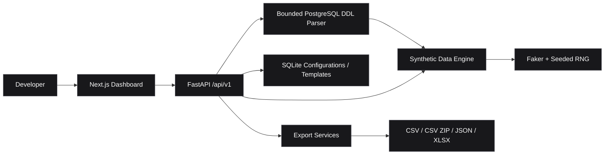

<div align="center">


### Developer tools. One workspace.

**Synthetic data · Reusable templates · Reliable testing**

[](#features)
[](https://nextjs.org/)
[](https://www.typescriptlang.org/)
[](https://fastapi.tiangolo.com/)
[](https://python.org/)

[Overview](#overview) · [Features](#features) · [Architecture](#architecture) · [Quick Start](#quick-start) · [Roadmap](#roadmap)

</div>

---

## Overview

**ALZA DevKit** is an internal developer toolkit for building, testing, and maintaining software projects from a single workspace. It brings repeatable development utilities into a clean web interface backed by a modular Python API.

> **V0.3.0 — Database Schema Importer:** release verification complete on 2026-10-11; ready for release, not published by this verification. Includes the Household Generator and Custom Dataset Builder. API Testing Lab and operational modules remain planned.

## Features

<table>
<tr><td width="50%" valign="top">

### 01 / Mock Data Factory
**Available**

- Synthetic household records with Filipino-style Faker names
- Configurable row count (1–1,000)
- Reproducible results with a random seed
- Paginated dataset preview
- CSV, JSON, and Excel exports
- Input validation and spreadsheet-formula protection

</td><td width="50%" valign="top">

### 02 / Custom Dataset Builder
**Available**

- Configurable fields, typed constraints and computed fields
- Seeded generation and CSV / JSON / Excel downloads
- SQLite-backed saved templates and JSON import/export
- Built-in Student Enrollment preset

</td></tr>
<tr><td width="50%" valign="top">

### 03 / Database Schema Importer
**Available in V0.3.0**

- Paste or upload PostgreSQL DDL and inspect tables, keys and relationships
- Review field mappings, select tables and configure row counts
- Generate parent-first records with composite foreign-key integrity
- Download JSON, CSV ZIP with manifest, or multi-sheet Excel
- Save, rename, import and export durable schema configurations

</td><td width="50%" valign="top">

### 04 / Developer Operations
**Planned**

- Database inspection
- Code quality auditing
- Deployment health monitoring
- Engineering reports

</td></tr>
</table>

## Architecture



```text
alza-devkit/
├── apps/
│   ├── web/          # Next.js, TypeScript, Tailwind, shadcn/ui
│   └── api/          # FastAPI, Faker, SQLite, OpenPyXL, Pytest
├── docs/             # Implementation guides
├── scripts/          # Browser verification scripts
├── infra/            # Infrastructure workspace
└── storage/          # Local workspace data
```

## Quick Start

**Requirements:** Node.js, npm, Python 3.12+, and [uv](https://docs.astral.sh/uv/).

```powershell
git clone https://github.com/SPATIBAIII/alza-devkit.git
cd alza-devkit
```

**Terminal 1 — Backend**

```powershell
cd apps/api
uv sync
uv run uvicorn app.main:app --host 127.0.0.1 --port 8000
```

**Terminal 2 — Frontend**

```powershell
cd apps/web
npm ci
npm run dev -- --hostname 127.0.0.1
```

| Service | Address |
| :-- | :-- |
| Dashboard | http://localhost:3000 |
| API docs | http://127.0.0.1:8000/docs |
| Health check | http://127.0.0.1:8000/api/v1/health |

Copy `apps/web/.env.example` to `apps/web/.env.local` if you need to configure `NEXT_PUBLIC_API_BASE_URL`.

**Troubleshooting**

- **Port conflicts**: If port 8000 or 3000 is already in use, modify the port in the startup commands.
- **uv not found**: Install uv from https://docs.astral.sh/uv/ before running the backend.
- **npm errors**: Ensure Node.js 18+ is installed. Run `npm ci` to clean install dependencies.
- **Database not persisting**: Set `DATA_FACTORY_DB` environment variable to an absolute path before starting the API.

## Generate a Dataset

Open **Mock Data Factory** and select either **Household Dataset** or **Custom Dataset**. The custom builder lets you configure fields, validate constraints, generate records, preview results, and export files. Save custom templates to reuse them after restarting the application.

The **Student Enrollment** preset is a convenient starting example.

### API examples

```http
GET /api/v1/data-factory/households?count=5&seed=42
POST /api/v1/data-factory/custom/validate
POST /api/v1/data-factory/custom/generate
POST /api/v1/data-factory/custom/export?format=xlsx
GET /api/v1/data-factory/templates
```

Supported export formats: `csv`, `json`, `xlsx`.

## Using the Database Schema Importer

1. Open **Database Schema Importer** in the sidebar.
2. Paste PostgreSQL DDL, upload a `.sql` file, or choose **Example Schema**, then **Parse Schema**.
3. Inspect types, keys, defaults, enum domains and parent relationships.
4. Configure field mappings, table selection, row counts and seed; **Validate Schema**.
5. **Save Configuration**, then generate and download **JSON**, **CSV ZIP**, or **Excel**.
6. Use **Saved schemas** to reopen, rename, export, import or delete configurations.

SQL is parsed as text and never executed; no PostgreSQL server or credentials are needed.
Supported imports are limited to documented `CREATE TABLE`, `CREATE TYPE AS ENUM`, and
`ALTER TABLE ADD` constraints. Generation supports up to 20 tables, 50 columns per table,
1,000 rows per table and 5,000 rows total. Cycles, self-references and overlapping foreign
keys are rejected. Defaults are retained for inspection, not evaluated.

Saved configurations and custom templates use SQLite at
`apps/api/app/data/templates.sqlite3` by default. Set `DATA_FACTORY_DB` to an absolute,
durable path before starting the API to override it; keep that path across restarts.
See the [Database Schema Importer guide](docs/database-schema-importer.md) for the
supported SQL subset, architecture, API, constraints, security protections and limitations.

## Verification

```powershell
# apps/api
uv run python -m pytest -q

# apps/web
npx tsc --noEmit
npm run lint
npm run build
```

For real browser acceptance, start the production web server (`npm run start` after
building), leave API port 8000 free, then run from `apps/api`:

```powershell
uv run --with playwright python ../../scripts/check-schema-importer.py
```

The script requires Microsoft Edge, starts its own isolated API/SQLite store, verifies
actual downloads, stops and restarts the backend to check persistence, and runs the
Household Generator and Custom Dataset Builder browser regression suites. It prints
the location of traces, screenshots, downloads and process-restart evidence.

Verified on **2026-10-11**: **217 backend tests passed** (one Starlette/httpx
deprecation warning), TypeScript/ESLint/production build passed, and **14 real
Edge browser acceptance groups passed**, including both existing generator suites.
An actual API restart preserved a saved schema and reproduced all 90 generated
records. Desktop and 320px/390px mobile viewports were tested; native mobile and
other browser engines were not. These are recorded local results, not live CI.

## Roadmap

- [x] Next.js dashboard and navigation
- [x] FastAPI backend and health endpoint
- [x] Mock Data Factory — household preset
- [x] Dataset preview and CSV / JSON / XLSX exports
- [x] Custom Dataset Builder and saved templates
- [x] Database Schema Importer
- [ ] API Testing Lab
- [ ] Code Auditor
- [ ] Deployment Monitor

## Documentation

- [Mock Data Factory — implementation and verification](docs/mock-data-factory.md)
- [Custom Dataset Builder](docs/custom-dataset-builder.md)
- [Database Schema Importer — V0.3.0 guide and verification](docs/database-schema-importer.md)
- [FastAPI application guide](apps/api/README.md)

## Security & Limits

ALZA DevKit is an **internal localhost-oriented MVP**, without authentication or authorization. Do not expose it publicly without hardening. Generate synthetic data only and do not commit secrets, real personal information, or local SQLite databases.

Current limits: **1,000 rows**, **50 fields**, **three computed operations**, and local SQLite storage.

## License

No license is specified. All rights reserved unless a license is added.

---

<div align="center">

<sub>ENGINEERED FOR BETTER DEVELOPMENT WORKFLOWS</sub>

**ALZA DEVKIT** · Build / Test / Ship

</div>
