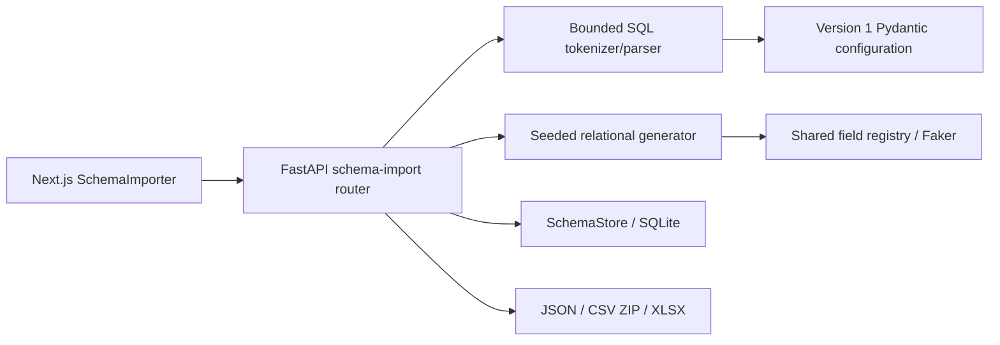

# Database Schema Importer — V0.3.0

Import PostgreSQL table definitions, inspect their structure, configure synthetic
field mappings, and download related datasets. No PostgreSQL server or database
credentials are needed. SQL is parsed as text and is **never executed**.

## Setup and workflow

Requirements: Python 3.12+, uv, Node.js compatible with the installed Next.js 16
release, and npm. Use the committed `uv.lock` and `package-lock.json`.

From the repository root, in separate PowerShell terminals:

```powershell
cd apps/api
uv sync
# Optional: set an absolute, durable path before starting the API.
$env:DATA_FACTORY_DB = 'C:\alza-data\templates.sqlite3'
uv run uvicorn app.main:app --host 127.0.0.1 --port 8000
```

```powershell
cd apps/web
npm ci
npm run dev
```

Open http://localhost:3000 and choose **Database Schema Importer**. The web API
base defaults to `http://localhost:8000`; `NEXT_PUBLIC_API_BASE_URL` overrides it.
For production builds, set this variable before `npm run build`, then use
`npm run start`. The API permits the localhost/127.0.0.1 frontend origins on port
3000. Interactive API documentation is at http://127.0.0.1:8000/docs.

1. Paste SQL, choose **Example Schema**, or upload a UTF-8 `.sql` file; click
   **Parse Schema**.
2. Inspect tables, types, nullability, keys, supported CHECK comparisons, defaults,
   enum domains and relationships. **Inspect parent table** follows a relationship.
3. Configure table selection, row counts, field generators/options, a name and seed.
   Select required parents too. **Validate Schema** actually attempts generation.
4. Save the configuration if needed, then generate. Preview tables in pages of 25
   rows and download JSON, CSV ZIP or Excel. Editing the configuration clears the
   generated preview so downloads cannot silently use stale settings.
5. **Saved schemas** supports opening, renaming, exporting, importing and deleting
   configurations. Importing configuration JSON creates a new UUID.

## Architecture and persistence



Frontend components live in `apps/web/src/components/schema-import`, with types in
`src/types/schema-import.ts` and API access in `src/lib/schema-import-api.ts`.
The backend router is `apps/api/app/api/v1/schema_import.py`; parsing, models,
generation, exports and storage live in `app/modules/schema_import`.

`SchemaStore` reuses the Custom Dataset Builder's SQLite connection lifecycle but
stores schema configurations in a separate `imported_schemas` table. Without an
override, the database is `apps/api/app/data/templates.sqlite3`. `DATA_FACTORY_DB`
changes that path. Each request opens a connection; mutations commit before the
connection closes. Definitions are validated JSON with `version: 1`,
`dialect: "postgresql"` and a server-assigned UUID. Table identities always quote
both components, for example `"public"."students"`, to avoid collisions involving
schema names, periods or quoted identifiers.

Keep the same database path and durable storage across restarts. Browser storage
is not the source of truth. Save explicitly before reloading; unsaved edits and
generated previews are held in React state. Exports are generated in memory.
Preserve/back up the SQLite database or export configurations before removing
local storage. There is no multi-user ownership or migration service.

## Supported PostgreSQL syntax

This is a deliberately bounded DDL subset, not a general PostgreSQL parser or
complete `pg_dump` importer. Unsupported constructs fail instead of being ignored.

| Construct | Support |
| --- | --- |
| Tables | `CREATE TABLE [IF NOT EXISTS] [schema.]name (...)` |
| Enums | `CREATE TYPE [schema.]name AS ENUM ('a', 'b')`, declared before use |
| Added constraints | `ALTER TABLE [schema.]name ADD [CONSTRAINT name]` followed by one supported table constraint |
| Identifiers | Unquoted identifiers folded to lowercase; double-quoted names preserve case, escaped quotes and periods; omitted schema is `public` |
| Comments | `--` line comments and nested `/* ... */` comments |
| Keys | Inline/table `PRIMARY KEY`, `UNIQUE`, `REFERENCES` / `FOREIGN KEY`; composite table keys |
| Nullability | `NULL`, `NOT NULL`; primary keys are required |
| FK actions | `ON DELETE` / `ON UPDATE`: `NO ACTION`, `RESTRICT`, `CASCADE`, `SET NULL`, `SET DEFAULT` (metadata only) |
| CHECK | One numeric column compared to a numeric literal using `>`, `>=`, `<`, `<=`, `=`, `<>` |
| Defaults | Literals, booleans, NULL, signed numbers, parentheses, simple casts, `current_date`, `current_timestamp`, `now()`, `gen_random_uuid()`, `uuid_generate_v4()`, `nextval('sequence'::regclass)`; retained as text, never evaluated |

Separate statements with semicolons. An omitted referenced-column list resolves to
the declared parent primary key. `IF NOT EXISTS` does not allow duplicate table
definitions within the same import. Unqualified names always resolve to `public`;
there is no `search_path` evaluation.

Supported types:

- `smallint`, `integer`, `bigint`, `serial`, `bigserial`; aliases `int`, `int2`,
  `int4`, `int8`.
- `varchar`, `character varying`, `char`, `character`, `text`; character lengths
  from 1 to 10,485,760 are accepted in declarations, subject to generation limits.
- `boolean` / `bool`, `uuid`, `date`.
- `timestamp`, `timestamp without time zone`, `timestamp with time zone`,
  `timestamptz`; optional precision 0–6.
- `numeric`, `decimal` with optional precision 1–1000 and scale 0–precision;
  `real`, `double precision`, `float4`, `float8`.
- Previously declared enum types, including schema-qualified enum names.

Example:

```sql
CREATE TABLE public.students (
  id SERIAL PRIMARY KEY,
  first_name VARCHAR(80) NOT NULL,
  email TEXT UNIQUE
);
CREATE TABLE public.enrollments (
  id SERIAL PRIMARY KEY,
  student_id INTEGER NOT NULL REFERENCES public.students(id),
  quantity INTEGER CHECK (quantity >= 1)
);
```

## API endpoints

All paths below are relative to `/api/v1/schema-import`. JSON request bodies use
the models shown in `/docs`; unknown fields are rejected.

| Method and path | Request / result |
| --- | --- |
| `POST /parse` | `{ "sql": "CREATE TABLE ...", "name": "Example" }` → configuration with suggested mappings and warnings |
| `POST /validate` | Configuration → `{valid, message, order}` after full generation validation |
| `POST /generate` | Configuration → `{name, seed, total_records, order, tables, fields, relationships}` |
| `POST /export?format=json\|csv\|xlsx` | Configuration → attachment; default `json`, `csv` produces a ZIP |
| `GET /schemas` | List saved configurations, newest first |
| `POST /schemas` | Configuration → saved configuration, HTTP 201 |
| `POST /schemas/import` | Same validated create operation; assigns a new UUID, HTTP 201 |
| `GET /schemas/{id}` | Saved configuration |
| `PUT /schemas/{id}` | Replace configuration / rename, preserving path UUID |
| `DELETE /schemas/{id}` | Delete; HTTP 204 |
| `GET /schemas/{id}/export` | Configuration JSON attachment |

Bad syntax, invalid configuration and unsatisfiable generation return 422. Missing
saved UUIDs return 404; oversized request bodies return 413; storage errors return
503 with a generic message. Malformed UUIDs return 422. Parsing/saving structural
configuration does not guarantee it is generatable: use `/validate` to check
relationships and mapping feasibility.

## Data generation and relationship constraints

The importer shares the Custom Dataset Builder field registry, using its own
seeded `random.Random` and `Faker("en_US")` instances. A nonnegative integer seed
up to 9,007,199,254,740,991 reproduces the same configuration with the same locked
dependencies. Changing table order, mappings or counts can change generated values.

Type and column-name hints suggest sequences for serial/integer primary keys,
names/email/date generators for recognized column names, and numeric, boolean,
UUID, enum or string generators for other columns. Review these suggestions;
they do not infer business rules from arbitrary names. The UI exposes numeric
ranges/precision, string lengths/prefixes/suffixes, sequence start/step/padding,
date ranges and enum values. Computed generators are not offered by the importer.

Generation sorts selected tables into parent-first dependency order. Foreign-key
values come from complete parent key tuples, never independently sampled
components. Parent pools are shuffled and cycled, with bounded retries when other
constraints conflict. FK column mappings are retained but are superseded by the
relationship. Referenced columns must match a declared primary or unique key in
the same order, with compatible types. Non-null parent keys must be available.

Primary/unique keys, nullability, SQL domains, length limits and supported CHECKs
are checked on actual generated rows, including values copied from parents.
Unique keys use normalized values for CHAR, UUID, date/time and real types, and
allow repeated tuples containing NULL. Known finite generator domains and unique
FK capacity are checked; remaining collisions use bounded retries. Valid SQL can
still need different mappings or counts to generate successfully.

Missing parents, excluded required parents, empty required parent tables, cycles,
self-references, incompatible key types and overlapping foreign keys are rejected.
FK actions are inspection metadata; no updates, deletes or cascades are executed.

## Security protections and resource limits

- Imported SQL is tokenized locally; no SQL execution, target DB connection,
  credential collection or evaluation of default expressions occurs.
- Configuration models forbid extra fields, validate enum/generator options and
  identifiers, and restrict versions and dialects. SQLite queries parameterize
  identifiers/JSON as stored values; UUID validation protects configuration routes.
- SQL: 262,144 UTF-8 bytes, 40,000 tokens, 200 statements, nesting depth 32,
  quoted token content up to 4,096 characters; identifiers at most 63 UTF-8 bytes.
- At most 20 tables and 50 columns per table; up to 500 enum values. Configuration
  requests are bounded to 2,000,000 bytes, including chunked HTTP bodies.
- At most 1,000 rows per table and 5,000 selected rows total; zero-row tables are
  allowed when relationship requirements permit them.
- At most 2,000 attempts per row, 150,000 row attempts and 500,000 field attempts;
  generated row JSON is limited to 10 MB, final exports to 25 MB.
- Spreadsheet exports escape formula-like text, sanitize workbook control
  characters, and use safe, unique archive filenames/worksheet titles. Dataset
  downloads set `X-Content-Type-Options: nosniff`.

This remains a trusted local development tool. Authentication, authorization,
tenant isolation, rate limiting and public deployment hardening are not provided.
CORS is not authentication. Generated datasets are synthetic; no real personal
data is required.

## Export formats

| Format | Contents |
| --- | --- |
| JSON | Metadata, seed, total count, parent-first order, field lists, relationships and a record array per fully qualified table identity; original text values preserved |
| CSV ZIP | One UTF-8 BOM CSV per table plus `manifest.json` with metadata, field lists, relationship/order information and table-to-filename mapping; empty tables retain headers |
| Excel (`xlsx`) | One worksheet per table in generation order, ordered column headers, frozen header row and autofilter; numbered/sanitized titles limited to 31 characters |
| Configuration JSON | Versioned schema, mappings/options, selected tables, counts and seed; contains no generated records |

Downloads regenerate from the current configuration and seed. Spreadsheet-safe
escaping can change text representation compared with JSON. CSV/Excel do not
preserve SQL type semantics; Excel does not include the JSON manifest. No SQL
INSERT export or direct database insertion is provided.

## Limitations

- Unsupported SQL includes DML, DROP, views, indexes, triggers, functions, schemas,
  sequences as standalone statements, extensions, identity/generated columns,
  arrays, JSON/JSONB, domains, arbitrary expressions, compound CHECKs, deferrable
  constraints and general ALTER operations. Full PostgreSQL dumps require trimming
  to the documented subset.
- Defaults do not generate values. Nullable columns are modeled, but this importer
  does not expose a null probability and its normal generators produce values.
- Numeric generation uses bounded Python numbers, at most six decimal places;
  accepted PostgreSQL precision is not a promise of arbitrary-precision output.
  JavaScript and Excel can lose precision for large integers.
- Built-in timestamp generation uses whole seconds; timestamptz receives UTC.
  Date defaults cover 2000-01-01 through 2025-12-31 unless configured otherwise.
- Generated strings and retry/output budgets are smaller than many SQL domains.
  CHECK predicates filter candidates rather than automatically adjusting mappings.
- Cyclic/self-referencing/overlapping relationships are unsupported. This is not
  PostgreSQL execution or a substitute for testing generated data against the
  target database's full semantics.
- Local SQLite configuration storage has no users, revision history or concurrent
  edit conflict resolution. Requests generate and export in memory.

## Best practices

### Schema preparation
- Trim PostgreSQL dumps to only the `CREATE TABLE`, `CREATE TYPE AS ENUM`, and
  `ALTER TABLE ADD` statements you need
- Remove views, indexes, triggers, and functions before importing
- Ensure foreign key relationships are clearly defined with proper types
- Keep table and column names under 63 characters for compatibility

### Configuration management
- Save configurations after successful validation to avoid losing work
- Use descriptive names for saved schemas to easily identify them later
- Export configurations as JSON for version control or sharing
- Set the `DATA_FACTORY_DB` environment variable to a durable path for persistence

### Generation optimization
- Start with smaller row counts (10-50) to validate mappings before scaling up
- Review suggested field mappings and adjust them to match your use case
- Ensure parent tables are selected when generating tables with foreign keys
- Use the validation step to catch relationship and constraint issues early

### Data quality
- Review the generated preview data before exporting full datasets
- Adjust numeric ranges and string lengths to match realistic data patterns
- Use appropriate date ranges for your specific use case
- Consider using sequences for primary keys to ensure uniqueness

### Export workflows
- Choose JSON for full metadata preservation and programmatic consumption
- Use CSV ZIP when you need separate files per table with a manifest
- Select Excel for manual review and spreadsheet-based workflows
- Verify exported data size stays within your system's limits

## Repeatable release verification

Run backend tests and frontend checks:

```powershell
cd apps/api
uv run python -m pytest -q
```

```powershell
cd apps/web
npx tsc --noEmit
npm run lint
npm run build
npm run start
```

With the production web server running on port 3000, **leave API port 8000 free**
and run in another terminal:

```powershell
cd apps/api
uv run --with playwright python ../../scripts/check-schema-importer.py
```

The script uses installed Microsoft Edge through Playwright. It owns its API
process, creates an isolated SQLite database in a new temporary directory, saves
through the browser, terminates the API, checks it is unreachable, starts a new
process against the same file, reloads in the browser and compares regenerated
records. It never stops an API process it did not start.

Evidence includes `trace.zip`, screenshots, downloaded JSON/ZIP/XLSX,
`restart.json` (old/new PID and saved UUID), `api.log`, and `results.json` in the
printed temporary directory. The database remains there for inspection. The
script also runs the existing Household Generator and Custom Dataset Builder
browser regression scripts against that isolated API.

## Executed release results — 2026-10-11

**Ready for release within the documented local-tool scope.** All requested
acceptance categories were executed; no known acceptance blocker remains. This
verification did not create a Git tag, publish a release or deploy the application.

| Check | Final result |
| --- | --- |
| `uv run python -m pytest -q` | **217 passed**, 1 warning, 5.52 seconds |
| `npx tsc --noEmit` | Exit 0, no diagnostics |
| `npm run lint` | Exit 0, no ESLint findings |
| `npm run build` | Exit 0; Next.js 16.4.0 production build, `/` and `/_not-found` prerendered |
| Browser acceptance | **14/14 groups passed**, Edge 155.0.4283.45 on Windows, production frontend |
| Actual backend restart | Old PID **22476** terminated and unreachable; new PID **16880** started against the same SQLite file |
| Persistence result | Saved UUID `25ccdbb1-9ca0-4553-940f-9f1ff8f6566e` reopened after browser reload; all **90 records** and dataset metadata matched before/after restart |
| Responsive checks | 1440×1000 desktop; 320×844 and 390×844 mobile viewports; all five importer steps without document overflow, horizontal table scrolling works |

The 14 browser groups cover:

1. Example/pasted SQL import, table/type/key/CHECK inspection and parent navigation.
2. Mapping overrides and options, table row counts, seed, validation and saving.
3. Parent-first relationships, PK/unique/CHECK integrity, generated mapping values,
   table selection in preview, pagination and deterministic regeneration.
4. Real JSON, CSV ZIP/manifest and Excel downloads, with all table values checked.
5. Actual process termination, unreachable-service error, new process, browser
   reload, persisted configuration and identical regenerated output.
6. Excluded/empty parents, incompatible mappings, error recovery and stale preview
   invalidation.
7. Saved configuration rename, JSON export/import with new UUID, deletion and
   invalid configuration rejection.
8. Malformed, unsupported and destructive SQL; wrong-extension and oversized files.
9. SQL file upload, enum/default inspection, ALTER constraint and composite FK tuples.
10. Self-referencing relationship rejection.
11. Both mobile viewports, navigation, all five steps, generation, JSON download
    and contained table scrolling.
12. No uncaught browser JavaScript errors; configured Geist font also asserted.
13. Existing Household Generator browser suite: validation, generation, pagination,
    all exports, configuration snapshot behavior, network errors and mobile layout.
14. Existing Custom Dataset Builder browser suite: field editing, validation,
    generation, pagination, exports, saved template lifecycle and household switching.

Final local evidence directory:
`C:\Users\admin\AppData\Local\Temp\alza-v030-acceptance-d18yakmf`.
It contains the trace, desktop/mobile screenshots, downloaded files, SQLite
database, `restart.json`, API log and named pass groups in `results.json`.
Temporary evidence is not committed and may be removed by OS cleanup; rerun the
script to reproduce it.

Two small defects were fixed during verification: the health endpoint reported
0.1.0 instead of the application's 0.3.0, and a self-referencing CSS font variable
caused a serif fallback instead of the existing Geist font. The final build,
backend/static checks and complete browser suite passed after both fixes.

The backend warning is `StarletteDeprecationWarning`: use of httpx with
`starlette.testclient` is deprecated in favor of httpx2. It does not fail tests;
dependency migration was outside this release verification. Native mobile devices,
Firefox/WebKit, public deployments, load testing and live PostgreSQL execution
were not tested. Mobile results refer to real Edge rendering at emulated viewport
sizes, not native mobile browser certification.
